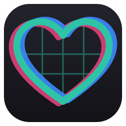
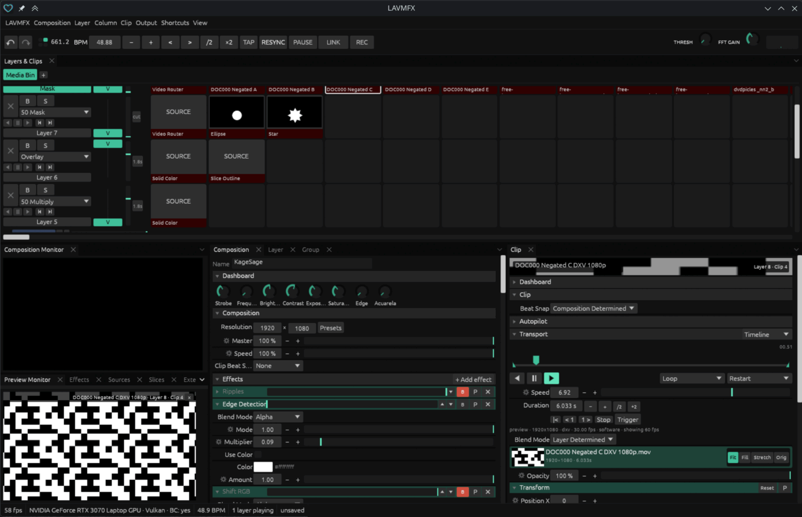
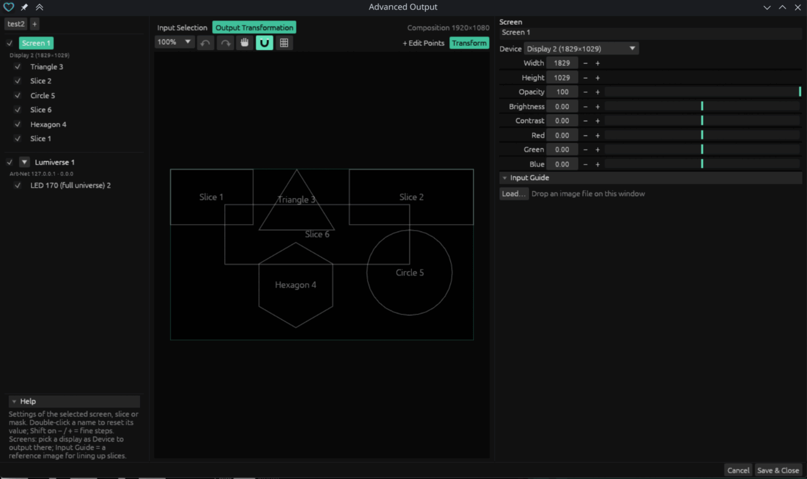
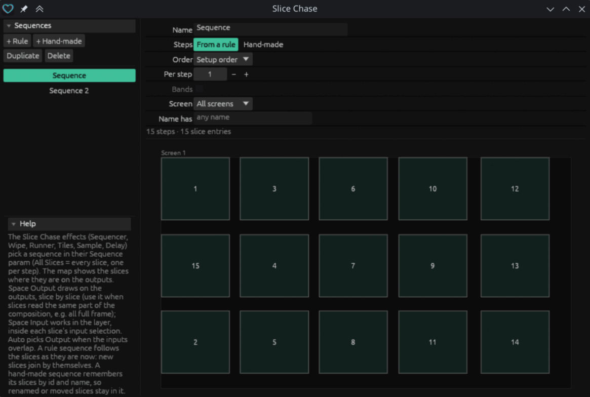
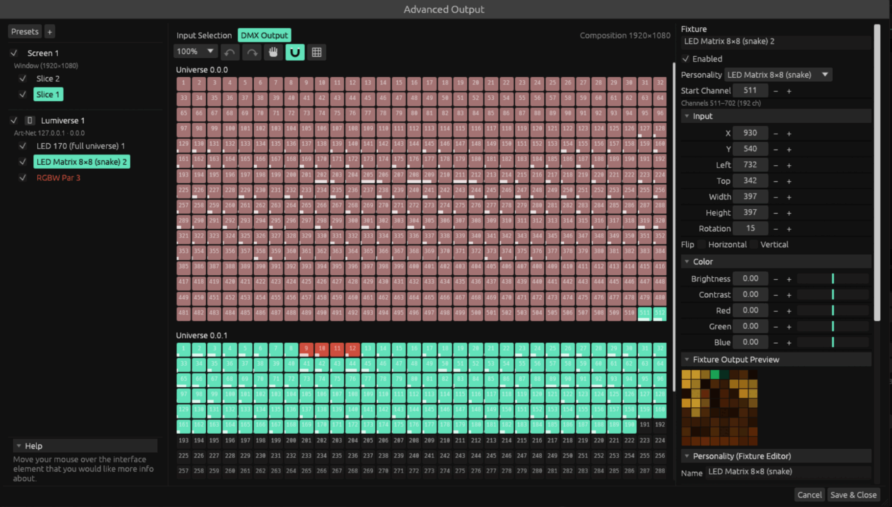

<p align="center"></p>

# LAVMFX

**Live Audio Visual Mapping FX Mixer**, say it **"love-me-FX"**.

Made by VJ Kage Bunshin.

LAVMFX is a **cross-platform**, free and open-source VJ and projection-mapping
app for live shows: trigger video clips from a grid, mix layers with blend
modes and transitions, stack real-time effects, drive any parameter from the
beat or the music, and map the result onto screens, slices and LED fixtures.
The M is for both *Mapping* and *Mixer*.

**One app on Linux, Windows and macOS**, with the same `.lavmfx`
show files and the same control over MIDI, OSC and REST, so a show moves
between machines as it is. A few extras are system-specific for now, like
PipeWire video sharing and FFGL plugins on Linux.

> Early days: the app works and is used for testing. The latest pre-release,
> 0.2.3, is on the [Releases](https://github.com/p0sthuman/lavmfx/releases)
> page ([what changed](CHANGELOG.md)). Linux and Windows builds are tested;
> on macOS, build it from source for now.



## What it does

- **Clips and layers**: decks of layers × columns, column launch, clip
  transport (loop, bounce, BPM sync, timeline, SMPTE), blend modes, transitions,
  groups, crossfader. Plays H.264 / HEVC / ProRes / HAP / DXV and more through
  FFmpeg, with hardware decoding where available; audio files and clip audio.
- **Media Manager**: every file a composition uses, with the missing ones
  marked; relink them one by one, by searching a folder for the file names, or
  by swapping a path prefix (a show moved to another drive or machine).
- **Effects**: about 100 GPU video effects and 17 generators, ISF shaders,
  FFGL plugins (Linux), and six audio effects, on clips, layers, groups and the
  composition.
- **Audio-reactive and tempo-driven**: FFT from an audio input or the clips,
  envelopes, LFO-style timelines, BPM sync, tap tempo, Ableton Link.
- **Projection mapping**: multiple outputs and fullscreen per display, slices,
  input crop, corner-pin / bezier / grid warp, masks, soft edges, polygon
  slices, a test card.
- **Slice Chase**: a built-in step sequencer for slices. Sequences come from a
  rule (left → right, centre → out, clockwise, rows or columns together,
  shuffle) or are made by hand on a map of the outputs, and step on the beat,
  by time, on FFT hits or by button. Six effects play them: Sequencer, Wipe,
  Runner, Tiles, Sample and Delay.
- **DMX / pixel mapping**: Art-Net and sACN output, lumiverses and fixtures,
  fixture library and editor, Art-Net input for control.
- **Live control**: keyboard and MIDI learn, OSC and a REST API, an
  Open Stage Control tablet layout (`remote/`), undo for every change.
- **Interop**: NDI in / out, PipeWire video sharing (Linux), recording and clip
  rendering, and import of Resolume Arena `.avc` compositions.

## Screenshots

**Projection mapping**: slices of any shape (rectangles, triangles, circles,
polygons) placed on an output, next to a DMX lumiverse.



**Slice Chase**: step sequences over the slices, built from a rule or by hand,
played by the Slice Chase effects.



**DMX / pixel mapping**: fixtures patched into universes, with a live preview
of what each fixture outputs.



## Run a build

Builds come as portable folders: unpack and run, nothing is installed.

| System | Package | Needs |
|---|---|---|
| Arch / CachyOS | `lavmfx-<version>-linux-x86_64-arch.tar.gz` | `ffmpeg` 9.x, PipeWire or PulseAudio, Vulkan driver |
| Other Linux (glibc 2.35+, e.g. Ubuntu 22.04+, Debian 12+, Fedora 36+) | `lavmfx-<version>-linux-x86_64.AppImage` (one file, FFmpeg included) | Vulkan driver, ALSA / PipeWire |
| Windows 10 / 11 (64-bit) | `lavmfx-<version>-windows-x86_64.zip` (FFmpeg DLLs included) | DirectX 12 or Vulkan GPU |

Start `lavmfx` (or `lavmfx.exe`). In the Linux folders,
`./install-menu-entry.sh` adds LAVMFX to your application menu.

Settings live in `~/.config/lavmfx` (Linux) or `%APPDATA%\lavmfx\config` (Windows).
Compositions are saved as `.lavmfx` files.

Optional at run time: the [NDI runtime](https://ndi.video/) for NDI sources and
outputs (Preferences › NDI).

### If something goes wrong

- **Log file**: Linux builds log to the terminal. Windows builds write
  `%APPDATA%\lavmfx\data\lavmfx.log`; its first line names the build. A crash
  or a stuck screen (the "watchdog" lines) is recorded there. Attach it to
  [bug reports](https://github.com/p0sthuman/lavmfx/issues).
- **Graphics**: LAVMFX uses Vulkan by default. `WGPU_BACKEND=dx12` (Windows)
  or `WGPU_BACKEND=gl` picks another backend, and
  `LAVMFX_PRESENT=vsync|novsync|mailbox|immediate` changes how frames reach the
  screen. On Windows, the `troubleshooting` folder has double-click tests for
  these that save their own log. DirectX 12 compiles the shaders slowly on the
  first start (up to a minute).
- **Fresh start**: rename the settings folder above.

## Build from source

You need Rust 1.95 or newer, a C/C++ compiler, CMake, clang (for bindgen), and
the development files of FFmpeg 8 or 9, PipeWire and ALSA (Linux).

```sh
cd app
cargo run --release -- [--output] [composition.lavmfx | media files…]
cargo test --workspace
```

Packages: see [`packaging/`](packaging/README.md).

## Get involved

What's done and what's planned: [ROADMAP.md](ROADMAP.md). Bug reports and
code are welcome, see [CONTRIBUTING.md](CONTRIBUTING.md) (AI coding agents:
[AGENTS.md](AGENTS.md)). Security problems:
[SECURITY.md](SECURITY.md).

## Licence

Copyright (C) 2026 Kage Bunshin (p0sthuman). LAVMFX is free software under the
[GNU General Public License v3.0 or later](LICENSE). Packages also bundle
third-party software, see [`packaging/THIRD-PARTY.md`](packaging/THIRD-PARTY.md).
Resolume and Arena are trademarks of their owner; LAVMFX is an independent
project that can import Arena `.avc` files and is not affiliated with Resolume.
